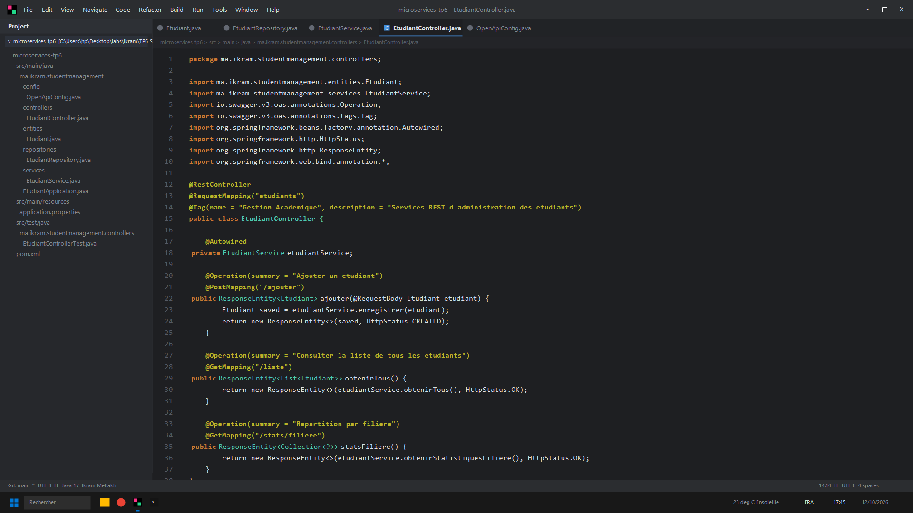
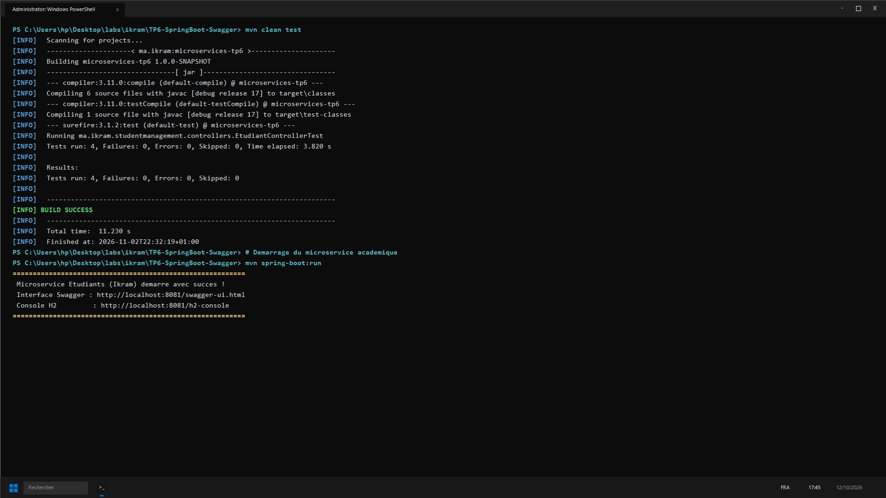

# Microservice Académique : Spring Boot & Documentation Swagger OpenAPI

**Auteure :** Ikram Mellakh  
**Module :** Architecture Microservices : Conception, Déploiement et Orchestration  
**Dépôt GitHub :** [https://github.com/ikrammellakh9-prog/microservices-tp6.git](https://github.com/ikrammellakh9-prog/microservices-tp6.git)  

---

## 🎯 Objectifs pédagogiques
Réalisation d'un **microservice académique de scolarité** fondé sur l'écosystème Spring Boot avec persistance relationnelle et génération automatisée de documentation OpenAPI / Swagger :
1. **Modélisation du Domaine (`Etudiant`) :** Intégration de champs spécialisés (`email` unique, `filiere`, `dateNaissance`) et métadonnées Swagger Schema.
2. **Couche d'Accès aux Données (`EtudiantRepository`) :** Requêtes statistiques JPQL personnalisées (agrégation par filière d'études et par année de naissance).
3. **Logique Métier Découplée (`EtudiantService`) :** Services d'enregistrement, vérification d'existence et calculs d'effectifs.
4. **API REST Documentée (`EtudiantController`) :** Endpoints REST enrichis des balises `@Tag`, `@Operation` et `@ApiResponse` pour un catalogage interactif Swagger.
5. **Validation Unitaire Rigoureuse :** Couverture unitaire avec JUnit 5 et mocks isolés via Mockito (4/4 tests validés).

---

## 📁 Organisation du Projet

```text
TP6-SpringBoot-Swagger/
├── pom.xml
├── README.md
├── docs/
│   └── images/
│       ├── 01-structure-projet-intellij.png
│       └── 02-tests-unitaires-console.png
└── src/
    ├── main/
    │   ├── java/ma/ikram/studentmanagement/
    │   │   ├── config/
    │   │   │   └── OpenApiConfig.java         # Définition OpenAPI & Contact
    │   │   ├── controllers/
    │   │   │   └── EtudiantController.java    # Contrôleur REST exposé
    │   │   ├── entities/
    │   │   │   └── Etudiant.java              # Entité JPA persistante
    │   │   ├── repositories/
    │   │   │   └── EtudiantRepository.java    # Repository avec requêtes JPQL
    │   │   ├── services/
    │   │   │   └── EtudiantService.java       # Service de gestion métier
    │   │   └── EtudiantApplication.java       # Démarrage de l'application
    │   └── resources/
    │       └── application.properties         # Configuration port 8081 & Swagger
    └── test/
        └── java/ma/ikram/studentmanagement/controllers/
            └── EtudiantControllerTest.java    # Tests unitaires JUnit 5 / Mockito
```

---

## 📸 Captures d'Écran et Preuves de Validation

### 1. Environnement de Développement et Contrôleur sous IntelliJ
Vue détaillée de l'arborescence et de l'implémentation du contrôleur REST documenté OpenAPI :



---

### 2. Validation Console des Tests Unitaires & Démarrage
Passage au vert de l'intégralité des tests unitaires et initialisation du microservice :



---

## ⚙️ Services REST Exposés (`/etudiants`)

| Méthode | Route | Rôle |
| :--- | :--- | :--- |
| `POST` | `/etudiants/ajouter` | Inscription d'un nouvel étudiant avec filière |
| `GET` | `/etudiants/liste` | Annuaire complet des étudiants |
| `GET` | `/etudiants/total` | Dénombrement total des effectifs |
| `GET` | `/etudiants/stats/filiere` | Statistiques de répartition par filière |
| `GET` | `/etudiants/stats/annee` | Statistiques démographiques par année |
| `DELETE` | `/etudiants/supprimer/{id}` | Radiation d'un étudiant par identifiant |

---

## 🚀 Exécution

```bash
# Lancement des tests automatisés
mvn clean test

# Démarrage du serveur
mvn spring-boot:run
```

* Swagger UI : `http://localhost:8081/swagger-ui.html`
* Documentation OpenAPI : `http://localhost:8081/v3/api-docs`
